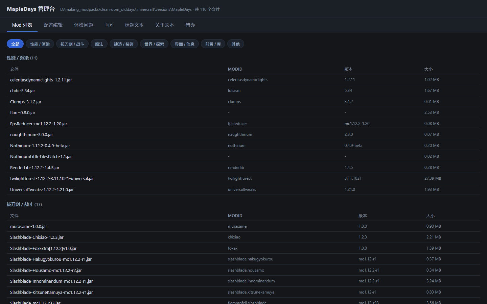

# MaplePanel

《打脸日常》整合包的本地管理面板。零依赖（Python 标准库 + 单页前端），双击即用。



## 它能做什么

| 页面 | 作用 |
|---|---|
| **Mod 列表** | 按性能/战斗/魔法/建造等分类浏览 `mods/`，显示 modid、版本、体积，并标出体检问题 |
| **配置编辑** | 浏览并编辑实例 `config/` 下的所有 `.cfg`，表单模式与原文模式随时切换，保存自动 `.bak` |
| **体检问题** | 聚合扫描结果（重复 modid、非法 `mcmod.info`、文件名不规范、依赖缺失等） |
| **Tips** | 直接编辑 `tips.cfg` 的 `customTips`，一行一条；**自动查重** |
| **标题文本** | 编辑 Better Title Screen 的主菜单多行文本 |
| **关于文本** | 编辑 MFnAbout 的正文（富文本，支持 `&` 颜色代码） |
| **待办** | JSON 存储的任务板：勾选、分区、归档、恢复、筛选，并同步导出 Markdown |

## 三个设计原则

1. **只改该改的地方。** 文本页保存时只替换目标多行块（`S:key < ... >`），文件里其它设置和注释原样保留。
2. **写之前先备份。** 所有写操作都会生成 `.bak`。
3. **不打断编辑。** Tips 查重在你停止输入 0.9 秒后自动跑，走独立接口，不写文件。

## 快速开始

```bash
# 启动（自动打开浏览器）
python server.py

# 指定端口
python server.py --port 8800

# 只起服务，不开浏览器
python server.py --no-browser
```

或者用控制台：

```bash
pythonw launcher.pyw     # 无控制台窗口
```

控制台可以**启动 / 停止 / 重启**后端、一键打开前端、查看日志，并实时显示服务状态与实例信息。

## 目录结构

```
MaplePanel/
  server.py        HTTP 服务 + 单页界面（七个标签）
  launcher.pyw     控制台（tkinter）：进程与端口管理
  panels.py        confg 多行块读写 + 文本相似度
  todo_store.py    待办 JSON 存储 / Markdown 导出 / 旧数据迁移
  maple.py         实例发现、jar 解析、体检规则（可单独 CLI 使用）
  data/todo.json   待办数据
```

## 待办的数据格式

```json
{
  "version": 2,
  "updated": "2026-11-23T16:24:00",
  "sections": ["下一步", "内容与编排", "技术债"],
  "items": [
    { "id": "t1", "text": "修 JEI 合成表", "section": "下一步",
      "done": false, "created": "...", "doneAt": null }
  ],
  "archive": []
}
```

- `data/todo.json` 是**唯一权威源**
- 每次保存同步重写一份 `待办清单.md`，方便 git diff 与日志引用
- 首次运行时若只有旧 Markdown，会自动迁移过来

## 相似度检查

```python
_NOISE = re.compile(r"[\s，。！？、．…~～!?,.:;；：（）()\[\]【】]+")   # 标点空白不参与比较
difflib.SequenceMatcher(None, a, b).ratio() >= 0.8
```

阈值默认 `0.8`。在真实的 140 条 Tip 上跑，能稳定抓出 3 对高度重复的条目。

## 环境

| 项 | 要求 |
|---|---|
| Python | 3.9+（只用标准库） |
| GUI 控制台 | 需要 tkinter（官方安装包自带） |
| 系统 | Windows（`netstat` / `taskkill` / `.ico` 图标为 Windows 实现） |

> 服务只监听 `127.0.0.1`，不对外暴露。

## 已知限制

- 文件名/路径假定 Windows
- 控制台依赖 `netstat -ano` 找进程，Linux 上要改
- 文本页保存会重写该多行块的注释行（块外注释不受影响）

## 许可

MIT
